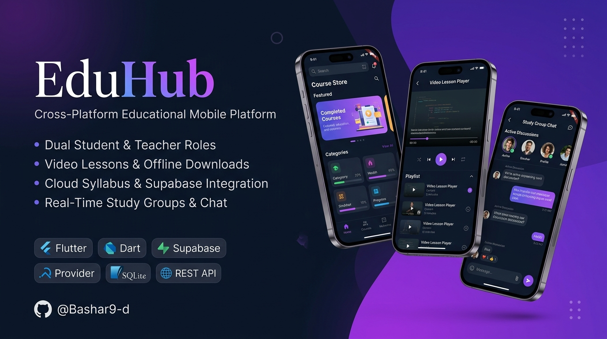
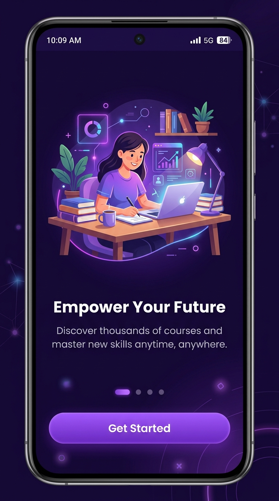
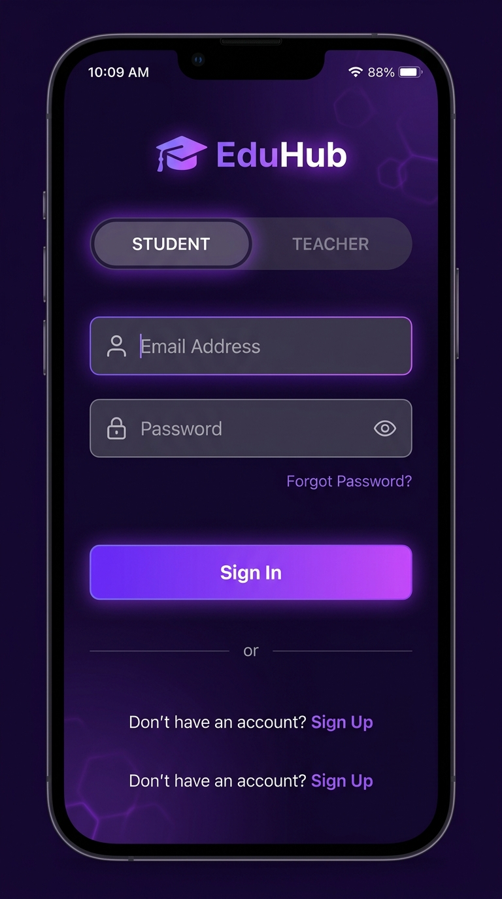
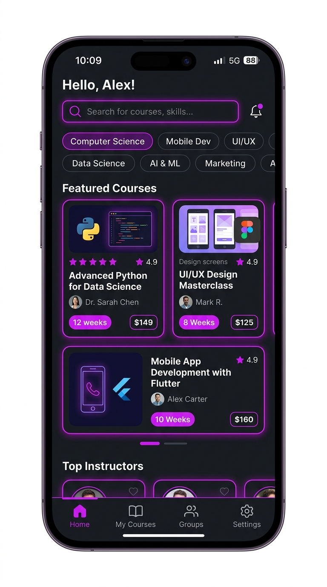
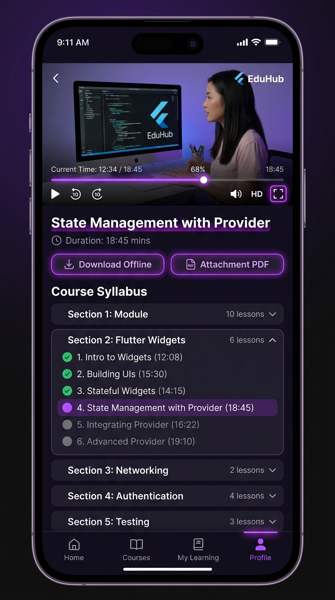
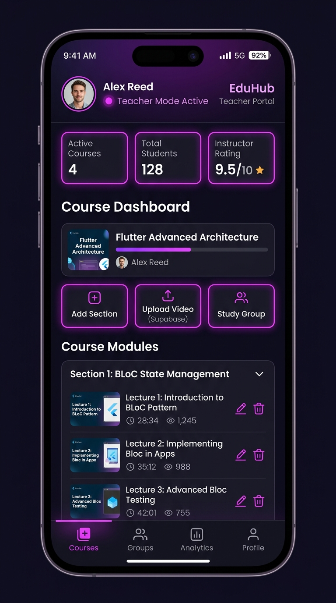
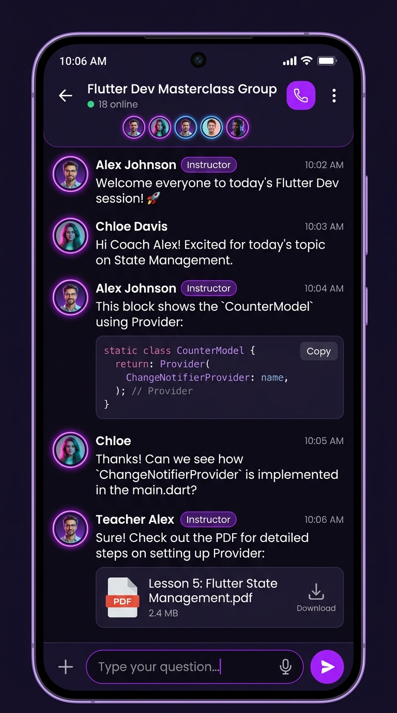
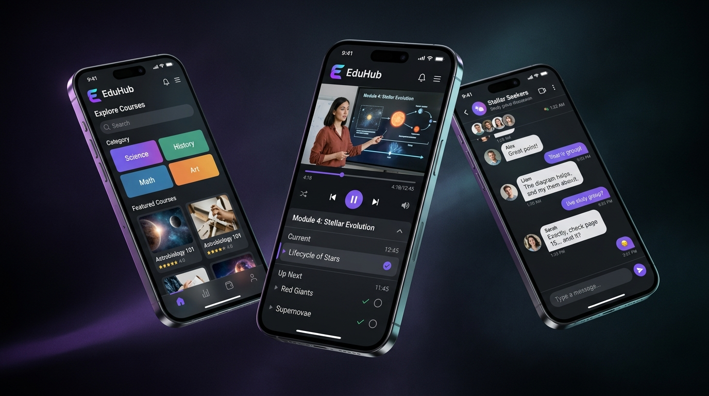

# 🎓 EduHub - Smart Educational Learning Platform



A modern, full-featured cross-platform **Educational Learning Management System (LMS)** mobile application built with **Flutter** & **Dart**. Designed with dual role workflows for **Students** and **Teachers**, interactive video courses powered by **Chewie**, cloud-synced course materials via **Supabase Storage**, offline video caching with **SQLite**, real-time study group chat channels, and an adaptive Dark/Light theme system.

---

## 🌟 Overview & Highlights

- **Dual-Role Architecture:** Dedicated interfaces and workflows tailored for both **Students** (learning, video streaming, offline caching) and **Teachers** (course creation, syllabus management, cloud media uploads).
- **Interactive Video Player:** High-performance video lecture streaming with playback speed control, fullscreen mode, timeline scrubbers, and lesson progress tracking.
- **Offline Mode:** Download course lessons directly to device storage using `Dio` and keep track of downloads with local `SQLite` (`sqflite`).
- **Cloud Storage & API Integration:** Course videos and PDF materials synced seamlessly with **Supabase Storage** and secure REST APIs.
- **Environment Security:** Hardcoded sensitive API keys and backend URLs removed and isolated into `.env` configuration powered by `flutter_dotenv`.
- **Dynamic Theming:** Seamless dark mode and light mode switching with persistent preferences via `SharedPreferences`.

---

## 📸 Screenshots & Showcase

### 📱 Core Application Flows

| Onboarding Flow | Dual-Role Auth Portal | Courses Catalog |
| :---: | :---: | :---: |
|  |  |  |

| Video Lesson Player | Teacher Management Portal | Study Group Discussion |
| :---: | :---: | :---: |
|  |  |  |

---

### 🎨 3D Showcase Presentation



---

## ✨ Features

### 👨‍🎓 Student Hub
- **Browse & Search:** Explore diverse course categories (Programming, Design, Business, AI & ML) with live search and filter chips.
- **Course Syllabus & Progress:** Structured modular sections with lessons checklist and completion indicators.
- **HD Video Streaming:** Fluid video playback powered by `Chewie` and `video_player`.
- **Offline Video Vault:** Download lectures to local storage to watch offline without internet connectivity.
- **Resource Attachments:** One-tap download and viewing of course PDF guides and exercise files.

### 👨‍🏫 Teacher Portal
- **Course Administration:** Create, update, and organize educational courses.
- **Curriculum Builder:** Add sections and upload video lectures and PDFs directly to **Supabase Storage**.
- **Student Engagement:** Monitor course enrollments and communicate through student discussion groups.

### 💬 Collaborative Study Groups & Chat
- **Real-Time Communication:** Dedicated study groups per course for peer-to-peer discussion and instructor Q&A.
- **Rich Messaging:** Send text, code references, announcements, and study material attachments.

---

## 🛠️ Tech Stack & Libraries

| Technology | Purpose |
| :--- | :--- |
| **[Flutter](https://flutter.dev)** (v3.x) | Cross-platform mobile development framework |
| **[Dart](https://dart.dev)** | Modern object-oriented programming language |
| **[Provider](https://pub.dev/packages/provider)** | Reactive state management (`ChangeNotifier`, `MultiProvider`) |
| **[Supabase](https://pub.dev/packages/supabase_flutter)** | Cloud BaaS for lesson media storage & assets |
| **[SQLite (sqflite)](https://pub.dev/packages/sqflite)** | Local relational database for offline video downloads |
| **[Dio](https://pub.dev/packages/dio) & [HTTP](https://pub.dev/packages/http)** | Efficient networking and high-speed chunked downloads |
| **[Chewie](https://pub.dev/packages/chewie)** & **video_player** | High-performance mobile video player suite |
| **[flutter_dotenv](https://pub.dev/packages/flutter_dotenv)** | Secure runtime environment variable management |
| **[flutter_screenutil](https://pub.dev/packages/flutter_screenutil)** | Adaptive multi-screen responsive UI scaling |
| **[shared_preferences](https://pub.dev/packages/shared_preferences)** | Persistent local key-value store (Theme, Auth Tokens) |

---

## 📁 Project Architecture

```
lib/
├── constant/
│   ├── env_config.dart          # Centralized .env loader & API URL getters
│   ├── helpers/                 # Theme, ThemeProvider, SharedPreferences helper
│   ├── otherwise/               # Color, image, string, and number tokens
│   ├── setting_constants/       # Setting UI layout helpers
│   └── widgets/                 # Reusable UI widgets & text field components
├── controller/
│   ├── begin_controller/        # Auth and Onboarding services
│   ├── downloads_db.dart        # SQLite database helper for offline videos
│   ├── otherwise/               # Courses, Lessons, Sections, Groups & Enrollments services
│   └── screens_controller/      # ViewModels and UI state controllers
├── model/                       # Data models (Courses, Lessons, Sections, Groups, Users, Messages)
├── view/
│   ├── begin_screens/           # Splash, Onboarding, Login, Register, Role Toggle
│   ├── settings_screens/        # Profile, Offline Videos, Theme, Contact, Privacy
│   ├── student_screens/         # Catalog, Syllabus, Video Player, Home, My Learning
│   └── teacher_screens/         # Teacher Dashboard, Sections & Uploads, Group Management
└── main.dart                    # Application entry point with Provider & Supabase initialization
```

---

## ⚙️ Environment Configuration (.env)

For security and flexibility, API endpoints and Supabase credentials are kept out of source control.

1. **Copy the example configuration:**
   ```bash
   cp .env.example .env
   ```

2. **Configure your credentials in `.env`:**
   ```env
   # Supabase Configuration
   SUPABASE_URL=https://your-project-id.supabase.co
   SUPABASE_ANON_KEY=your_supabase_anon_public_key_here

   # Backend API Base URL
   API_BASE_URL=https://your-api-domain.com
   ```

> 🔒 **Security Notice:** The `.env` file is excluded from Git tracking in `.gitignore`. Never commit production keys to public repositories.

---

## 🚀 Getting Started

### Prerequisites
- [Flutter SDK](https://docs.flutter.dev/get-started/install) (version 3.8.1 or higher)
- [Dart SDK](https://dart.dev/get-dart)
- Android Studio / Xcode / VS Code with Flutter extension
- Connected physical device or emulator

### Installation & Run

1. **Clone the repository:**
   ```bash
   git clone https://github.com/Bashar9-d/eduhub.git
   cd eduhub
   ```

2. **Set up environment variables:**
   ```bash
   cp .env.example .env
   ```

3. **Install dependencies:**
   ```bash
   flutter pub get
   ```

4. **Run the app:**
   ```bash
   flutter run
   ```

---

## 👤 Author

- **Bashar** - [GitHub Profile](https://github.com/Bashar9-d)

---

## 📄 License

This project is licensed under the MIT License - see the [LICENSE](LICENSE) file for details.
